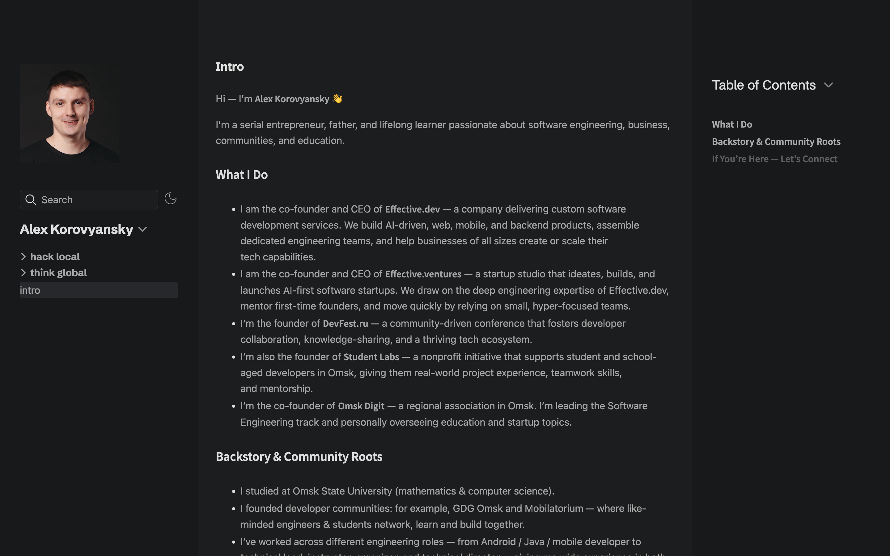

# alexkorovyansky.com

Digital Garden of Alex Korovyansky, live at https://alexkorovyansky.com.

Written in [Obsidian](https://obsidian.md), built with [Quartz 5](https://quartz.jzhao.xyz), and hosted on GitHub Pages.



## Want a website like this? 

You can set up your own in either of two ways:

- **Do it yourself:** Follow the guide [How to publish your Obsidian digital garden for free](https://alexkorovyansky.com/by-direct-link/how-to-publish-your-obsidian-digital-garden-for-free).
- **Ask an AI agent:** Give this prompt to Claude Cowork or ChatGPT Work:

  ```
  Follow the guide at https://alexkorovyansky.com/by-direct-link/how-to-publish-your-obsidian-digital-garden-for-free to publish my Obsidian digital garden.
  ```

## Published, unlisted, and draft pages

The properties at the top of a Markdown file control how it appears on the site:

```markdown
---
publish: <value>
unlisted: <value>
unindex: <value>
title: <value>
---
```

| What you want to control    | How                                                        |
| --------------------------- | ---------------------------------------------------------- |
| Published or draft          | `publish: true` publishes a page; otherwise it's a draft   |
| Shown in navigation         | Every page appears there, except pages in `by direct link` |
| Found in site search        | Add `unlisted: true` to keep a page out of site search, the sitemap, and RSS |
| Indexed by search engines   | Add `unindex: true` to tell search engines not to index a page |

Pages in `by direct link` can still be found through site search and by search engines. To prevent this, add both `unlisted: true` and `unindex: true` to the page.

This README has no `publish` property, so it isn't part of the site.

> [!WARNING]
> These properties only control what appears on the site. In a public repository, anyone can read every file, including drafts. Keep private notes out of it.

## Run locally

You need Node.js 24.

```sh
export QUARTZ_BUILD_ROOT="$HOME/.cache/quartz"
bash .quartz/ops/build.sh
bash .quartz/ops/local.sh
```

The site opens at http://localhost:8080. Run `build.sh` again to see new changes.

`QUARTZ_BUILD_ROOT` is optional. It keeps build files out of the repository, which helps if the repository is in a synced folder such as iCloud. Without it, they go to `.quartz/build`.

## Deploy

Every push to `main` builds and publishes the site through [`.github/workflows/deploy.yml`](.github/workflows/deploy.yml).
